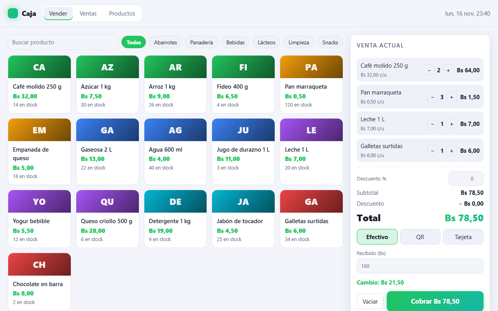

# Caja — point of sale

**[Try the live demo](https://chacolla2001-art.github.io/caja-pos/#demo)** · [Español](README.md)



A point of sale for small shops: take payments, track stock, print receipts and see the daily report. It runs in the browser with no server or installation, and stores data on the device.

## Features
- **Selling:** searchable catalog with categories, cart with quantities, percentage discount, and cash (with change), QR or card payments.
- **Receipt** ready for an 80 mm thermal printer.
- **Stock:** every sale decreases it; it never sells more than what is available and flags items to reorder.
- **Daily report:** number of sales, total, average ticket, totals by payment method and best sellers.
- **CSV export** to open sales in Excel.
- **Products:** add, remove and adjust stock.

## How it is built
Plain HTML, CSS and JavaScript — no frameworks, no dependencies.
- `src/logica.js` holds the business rules (totals, discounts, change, stock, report) as pure functions, separate from the UI, so they are tested on their own.
- Money is handled as **integer cents** to avoid rounding errors.
- `src/app.js` renders the UI and `src/datos.js` persists to `localStorage`.

```bash
npm test          # 11 business-rule tests
npm start         # opens the app at http://localhost:5180
```

The interface and identifiers are in Spanish.

MIT License.
