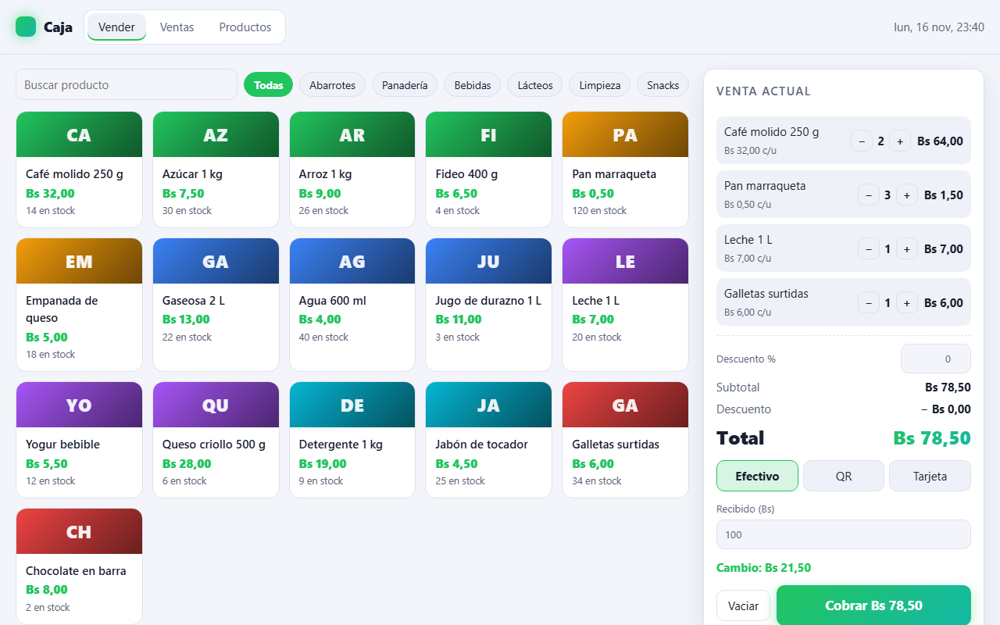

# Caja — punto de venta

**[Probar la demo en vivo](https://chacolla2001-art.github.io/caja-pos/#demo)** · [English](README.en.md)



Punto de venta para tiendas pequeñas: cobra, descuenta el stock, imprime el ticket y muestra el reporte del día. Funciona en el navegador, sin servidor ni instalación, y guarda los datos en el propio equipo.

## Qué hace
- **Vender:** catálogo con búsqueda y categorías, carrito con cantidades, descuento porcentual y pago en efectivo (con cálculo del cambio), QR o tarjeta.
- **Ticket** listo para imprimir en impresora térmica de 80 mm.
- **Stock:** cada venta lo descuenta; no deja vender más de lo que hay y avisa qué productos hay que reponer.
- **Reporte del día:** número de ventas, total, ticket promedio, total por método de pago y productos más vendidos.
- **Exportar a CSV** para abrir las ventas en Excel.
- **Productos:** alta, baja y ajuste de stock.

## Cómo está hecho
HTML, CSS y JavaScript sin frameworks ni dependencias.
- `src/logica.js` contiene las reglas (totales, descuentos, cambio, stock, reporte) como funciones puras, separadas de la pantalla. Por eso se prueban solas.
- El dinero se maneja en **centavos enteros** para no arrastrar errores de redondeo.
- `src/app.js` dibuja la pantalla y `src/datos.js` guarda en `localStorage`.

```bash
npm test          # 11 pruebas de las reglas de negocio
npm start         # abre la caja en http://localhost:5180
```

## Para un negocio real
Esta versión guarda los datos en un solo equipo. Para varias cajas o sucursales se conecta a una API con base de datos (ver [inventario-spring](https://github.com/chacolla2001-art/inventario-spring)), con usuarios y respaldo.

Licencia MIT.
